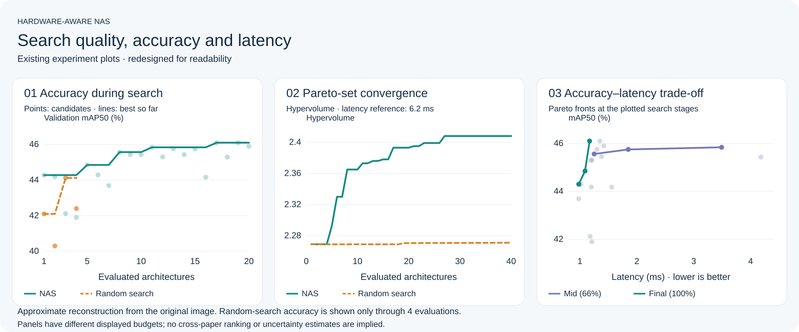
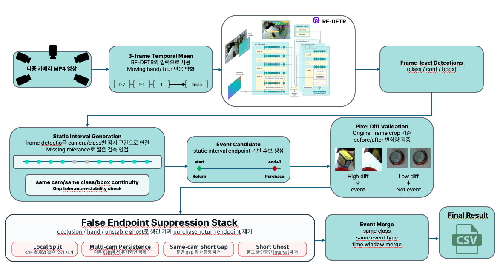
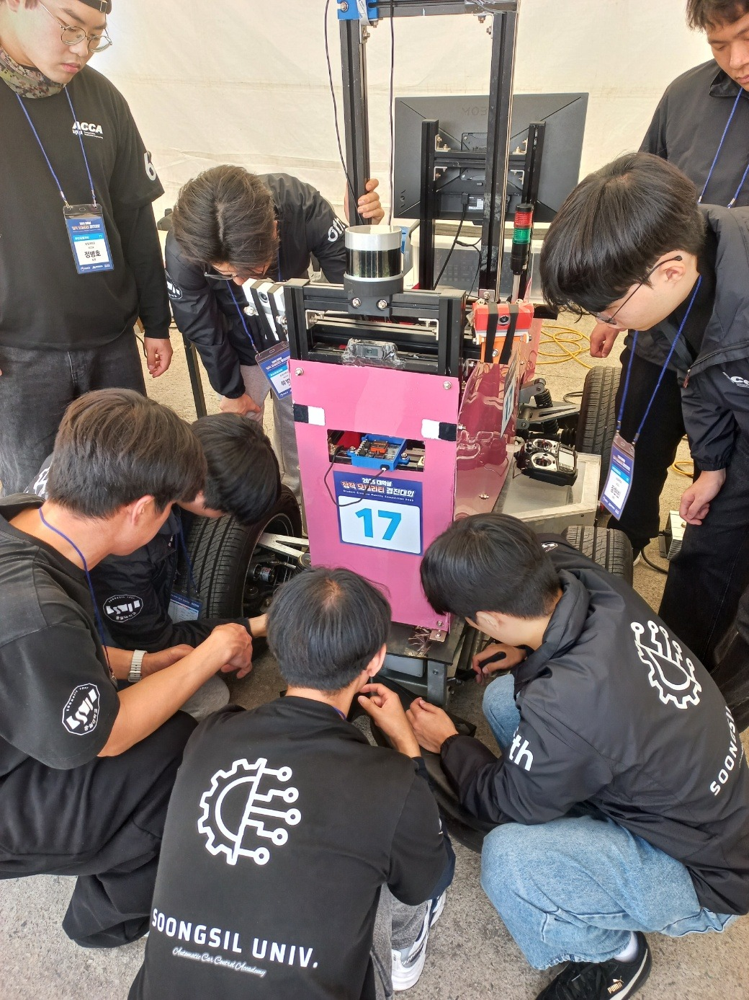
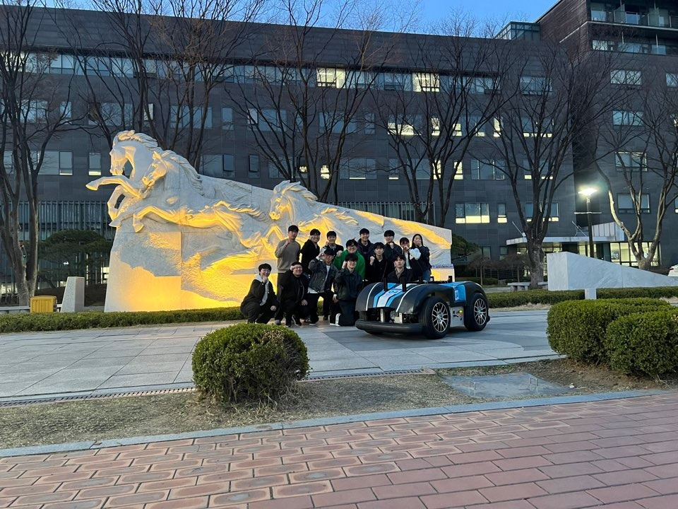

I'm a mechanical engineering undergraduate at **Soongsil University**, interested in **robot learning for manipulation**. I want to study how robots learn manipulation skills from demonstrations, and how trajectories can guide their actions.

My current arm project uses SO-101 and MoveIt 2. Previously, I worked on imitation learning for driving, detector architecture search, and real-vehicle control.

[Research blog](https://libok03.github.io/) · [Email](mailto:markpiano01@gmail.com)

## Projects

### SO-101: planning to physical motion
[**SO-101 Teleoperation & MoveIt 2 →**](https://github.com/libok03/maker_fair_2026_teleoperation_lerobot)  
`ROS 2 Humble` `MoveIt 2` `LeRobot` `Gazebo Harmonic` `ros2_control`

| Physical robot | Motor feedback | Motion planning |
| :---: | :---: | :---: |
| **5-axis arm + 1 gripper** | **6 STS3215 servos** | **3 planning pipelines** |
| SO-101 follower execution | Measured joint-state feedback | OMPL · Pilz · STOMP |

   
  MoveIt 2 plan → physical SO-101 follower → measured joint feedback in RViz

- Gazebo simulation, URDF/Xacro, MoveIt 2 configuration, and physical follower execution.
- **3 planning pipelines:** OMPL, Pilz, and STOMP.
- Motor setup and calibration tools, trajectory execution, and measured joint-state feedback.
- Ongoing work: teleoperation and demonstration-data workflows; intermittent gripper voltage alarms remain under investigation.

---

### Learning-based autonomous driving
[**VLA_Driving →**](https://github.com/libok03/VLA_Driving)  
`PyTorch` `TCP` `Imitation Learning` `ROS` `MORAI`

| Held-out prediction | Closed-loop evaluation | Neural inference |
| :---: | :---: | :---: |
| **0.2924 m** ADE | **100%** completion · **4 laps** | **11.02 ms** mean |
| **0.5225 m** FDE @ **2 s** | **0.38 m** mean error · **0.55 m** RMSE | **18.05 ms** p95 |

Measured in MORAI K-City; prediction accuracy, closed-loop performance, and model latency are separate evaluations.

   
  DRIVE / STOP / AVOID predictions · recorded-bag open-loop replay

Adapted **Trajectory-guided Control Prediction (TCP)** to MORAI: front-camera images, vehicle speed, and route conditions produce future waypoints and vehicle control.

- Camera-timestamp dataset alignment, human/teacher data preparation, training, evaluation, and ROS runtime integration.

**My contribution:** learning-model development, data collection and labeling, training and inference pipelines, and runtime integration. Earlier multimodal planner experiments are also retained in the repository.

System context and contribution boundaries

The broader vehicle system combines localization, route conditioning, and an independent Safety Monitor. The repository primarily provides TCP data conversion, training/evaluation, and earlier planner experiments; it does not contain the complete deployable vehicle stack.

MPC and local-route modules were implemented by other team members.  
[Team system repository →](https://github.com/libok03/ACCA2026)

---

### Hardware-aware neural architecture search
[**HW-NAS-YOLO →**](https://github.com/libok03/HW-NAS-YOLO)  
`YOLO11n` `NSGA-II` `Ray` `TensorRT FP16`

  

Search accuracy · Pareto-set convergence · Accuracy–latency trade-off. Approximate reconstruction from the archived figure.

Searching detector architectures under a joint **accuracy–latency objective**.

- **3 → 15 → 50 epochs:** multi-fidelity evaluation with Successive Halving.
- Block type, depth, and attention-module search with pretrained weight inheritance.
- Random Forest latency prediction with selective TensorRT FP16 hardware measurements.

**My contribution:** model training, experimental evaluation, manuscript writing, and poster preparation.

**Existing experiment plots**

| Best plotted validation mAP50 | Hypervolume at 40 evaluated architectures |
| :---: | :---: |
| **≈46.1%** · NAS at 20 architectures | **≈2.408 NAS / ≈2.271 Random Search** |

Approximate readings from the archived figure. The mAP Random Search curve ends at 4 architectures; hypervolume uses the figure's own reference convention.

[Methods, related work, and metric sources →](docs/hw-nas-comparison.md)

---

More projects — multi-camera perception and ERP42 autonomy

### Multi-camera inventory estimation
[**RF-DETR Based Inventory Management →**](https://github.com/libok03/RF_Detr_Based_Inventory_management)  
`RF-DETR` `YOLO` `OpenCV` `Temporal Filtering`

| mAP50–95 | Precision | Recall |
| :---: | :---: | :---: |
| **96.76%** | **98.40%** | **98.10%** |

**RF-DETR product-detection performance**, reported in the project presentation (slide 15). These are detector metrics; final inventory-count accuracy and purchase/return event F1 are separate evaluations.

  

Built a product-recognition and inventory-estimation system for **60 product classes across 5 camera views**. The event pipeline links frame-level detections into static intervals, validates purchase/return candidates with pixel differences, and uses cross-camera persistence to suppress false events caused by occlusion.

**My contribution:** dataset cleaning and label/bounding-box quality checks, RF-DETR training, temporal event-estimation pipeline development, and final report writing/organization.

---

### ERP42 real-vehicle robotics
[**ACCA 2025 →**](https://github.com/libok03/ACCA_2025)  
`ROS 2` `Path Planning` `State Machines` `MPC` `Sensor Integration`

  

**My contribution:** path planning, state-machine design, sensor integration, and MPC optimization/tuning on the ERP42 platform.

## Tools I use

**Learning:** Python · PyTorch · TensorRT · CUDA  
**Robotics:** C++ · ROS / ROS 2 · MoveIt 2 · Gazebo  
**Perception:** OpenCV · RF-DETR · YOLO  
**Development:** Linux · Git · Docker

Earlier simulation and reinforcement-learning experiments

| Project | Quantitative scope | Work |
| :--- | :--- | :--- |
| [UR5e pick-and-place](https://github.com/libok03/ros2_SimRealRobotControl) | **6-axis manipulator** + Robotiq **2F-85** | Gazebo simulation and MoveIt 2 pick-and-place |
| [PPO Swing-Up](https://github.com/libok03/PPO_SwingUp) | **2 poles · 8 parallel environments · 5M timesteps configured** | Continuous-control training and evaluation logging |
| [Atari DQN](https://github.com/libok03/Atari_DQN_Agent) | **2 game demos:** Q-Bert and Ms. Pac-Man | Visual reinforcement-learning experiments |
| [CartPole RL](https://github.com/libok03/CartPole_RL) | **4 agent variants · 300K episodes per agent configured** | DQN, DDQN, Dueling DQN, and QR-DQN training harness |

Training budgets above are code configurations; they do not imply completed runs or achieved rewards.

ACCA · Soongsil University

President, 2026. Coordinated autonomous-system projects, integration, and experiments.

  

